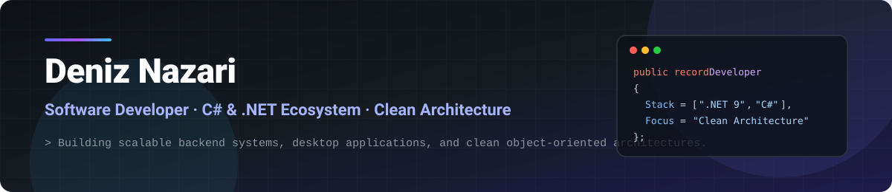

 

 

---

## 👨‍💻 About Me

Hi, I'm **Deniz Nazari** *(Official / Passport: Daniz Nazari)* — a **Software Developer** specializing in **Backend & Full-Stack Engineering** within the **C# & .NET ecosystem**, with a strong focus on **Business Process Digital Transformation** and **Artificial Intelligence**.

- 🏗️ **.NET Backend & Clean Architecture:** Designing modular, maintainable systems with `C# 13`, `.NET 9`, `ASP.NET Core Web API`, `Entity Framework Core`, `PostgreSQL`, and `Domain-Driven Design (DDD)` principles.
- 🔄 **Full-Stack & Digital Transformation:** Translating complex business processes into streamlined digital workflows across web and desktop (`Windows Forms`, `JavaScript`, `HTML5/CSS3`) platforms.
- 🤖 **AI & Intelligent Automation:** Integrating AI-assisted workflows, data pipelines (`Python`), and algorithmic problem-solving into modern software solutions *(and exploring procedural 3D simulation in C# as a hobby)*.

---

## 🛠️ Tech Stack & Tools

### Languages & Frameworks

### Architecture, Data, AI & DevTools

---

## 🚀 Featured Projects

<table>
  <tr>
    <td width="33%" valign="top">
      <h3>🗓️ <a href="https://github.com/DenizNazari/MyPlannerApp">MyPlannerApp</a></h3>
      

        <b>.NET 9 Clean Architecture Productivity &amp; Workflow Platform</b> 
        Engineered with decoupled <code>Domain</code>, <code>Application</code>, <code>Infrastructure</code>, <code>Api</code>, and <code>Tests</code> layers. Features hierarchical Task/Habit/Project entities, EF Core 9 Fluent API assembly scanning, PostgreSQL persistence, and streak analytics.
      

      

        <code>C# 13</code> <code>.NET 9</code> <code>EF Core 9</code> <code>PostgreSQL</code> <code>Clean Architecture</code>
      

    </td>
    <td width="33%" valign="top">
      <h3>🐉 <a href="https://github.com/DenizNazari/the-csharp-players-guide-quests">The C# Player's Guide — Quest Hub</a></h3>
      

        <b>Interactive C# Console &amp; Windows Forms Engineering Portfolio</b> 
        A modular collection of <b>25+ C# challenges &amp; Boss Battles</b> featuring an interactive CLI launcher, a responsive <b>Windows Forms 15-Puzzle</b> desktop application with inversion-parity solvability guarantees, and full EN/TR technical documentation.
      

      

        <code>C# 13</code> <code>.NET 9</code> <code>OOP</code> <code>Windows Forms</code> <code>Algorithms</code>
      

    </td>
    <td width="33%" valign="top">
      <h3>🎂 <a href="./projects/poffle/README.md">Poffle (Showcase)</a></h3>
      

        <b>Procedural 3D Simulation in C# (Hobby Project)</b> 
        Engineered with a <b>code-driven procedural architecture</b> in C# &amp; Unity 6. Features real-time single-mesh geometry extrusion across 7 nozzle profiles, surface-snapped raycast interaction, custom shaders, and JSON state persistence.
      

      

        <code>C#</code> <code>Procedural Geometry</code> <code>Custom Shaders</code> <code>3D Simulation</code>
      

    </td>
  </tr>
</table>

---

## 📊 GitHub Activity & Overview

  

---

## 📫 Contact

- 💼 **LinkedIn:** [linkedin.com/in/daniz-nazari-b351a0201](https://www.linkedin.com/in/daniz-nazari-b351a0201)
- 📧 **Email:** [nazaridenizmacs@gmail.com](mailto:nazaridenizmacs@gmail.com)
- 🌐 **Portfolio:** [deniznazari.github.io](https://deniznazari.github.io)
