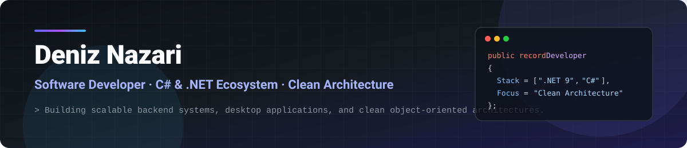

 

 

[-ef4444?style=for-the-badge)](./README.tr.md)

---

## 👨‍💻 Hakkımda

**C# ve .NET ekosistemi** başta olmak üzere Python ve modern web teknolojileriyle sürdürülebilir, iyi yapılandırılmış uygulamalar geliştirmeye odaklanan bir **Yazılım Geliştiriciyim**. Temiz domain modelleri, katmanlı backend mimarileri (**Clean Architecture**) ve etkileşimli masaüstü/web uygulamaları tasarlamaktan keyif alıyorum.

- 🏗️ **Mimari & Backend:** `.NET 9`, `ASP.NET Core Web API`, `Domain-Driven Design (DDD)` prensipleri ve birim testli (unit-tested) uygulama katmanlarıyla modüler çözümler tasarlama.
- 🧩 **Nesne Yönelimli Mühendislik (OOP):** C# OOP, algoritmalar, durum makineleri (state machines) ve masaüstü arayüz geliştirme (`Windows Forms`) konularında güçlü temel.
- 🌍 **Full-Stack & Otomasyon:** `Python`, `JavaScript`, `HTML5/CSS3` ve ilişkisel veritabanları kullanarak web platformları ve veri/otomasyon iş akışları geliştirme.

---

## 🛠️ Teknolojiler & Araçlar

### Diller & Framework'ler

### Mimari, Veri & Geliştirme Araçları

---

## 🚀 Öne Çıkan Projeler

<table>
  <tr>
    <td width="50%" valign="top">
      <h3>🗓️ <a href="https://github.com/DenizNazari/MyPlannerApp">MyPlannerApp</a></h3>
      

        <b>DEHB (ADHD) Odaklı Çok Platformlu Verimlilik ve Planlama Ekosistemi</b> 
        <b>.NET Clean Architecture</b> (<code>Domain</code>, <code>Application</code>, <code>Infrastructure</code>, <code>Api</code> ve <code>Tests</code>) ile geliştirildi. Hızlı görev yakalama akışları, hobi zaman bloklama, su tüketimi takibi, haftalık öncelik yönetimi ve etkileşimli sanal evcil hayvan sistemi içerir.
      

      

        <code>C#</code> <code>.NET</code> <code>Clean Architecture</code> <code>REST API</code> <code>Unit Testing</code>
      

    </td>
    <td width="50%" valign="top">
      <h3>🐉 <a href="https://github.com/DenizNazari/the-csharp-players-guide-quests">The C# Player's Guide — Quest Hub</a></h3>
      

        <b>Etkileşimli C# Konsol &amp; Windows Forms Mühendislik Portfolyosu</b> 
        Etkileşimli CLI başlatıcısı, çözülebilirlik garantili <b>Windows Forms 15-Puzzle</b> masaüstü oyunu, 24-bit ANSI TrueColor görselleştirme ve çift dilli (EN/TR) teknik dokümantasyon içeren <b>25+ C# problemi ve Boss Battle</b> koleksiyonu.
      

      

        <code>C# 13</code> <code>.NET 9</code> <code>OOP</code> <code>Windows Forms</code> <code>Algorithms</code>
      

    </td>
  </tr>
</table>

---

## 📊 GitHub İstatistikleri & En Çok Kullanılan Diller

---

## 📫 İletişim

- 💼 **LinkedIn:** [linkedin.com/in/deniz-nazari-b351a0201](https://www.linkedin.com/in/deniz-nazari-b351a0201/)
- 📧 **E-posta:** [bffdeniz@gmail.com](mailto:bffdeniz@gmail.com)
- 🌐 **Web:** [deniznazari.github.io](https://deniznazari.github.io)
