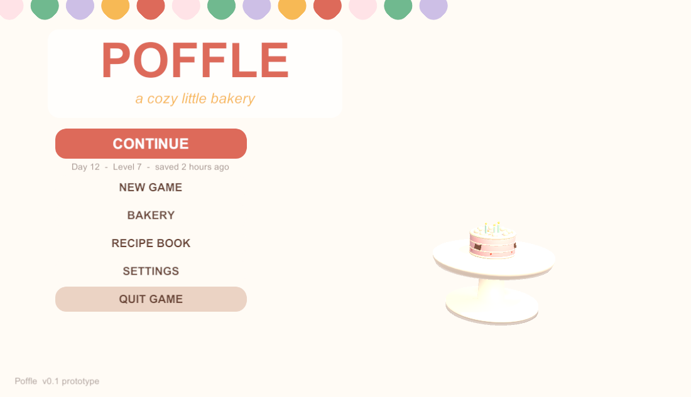
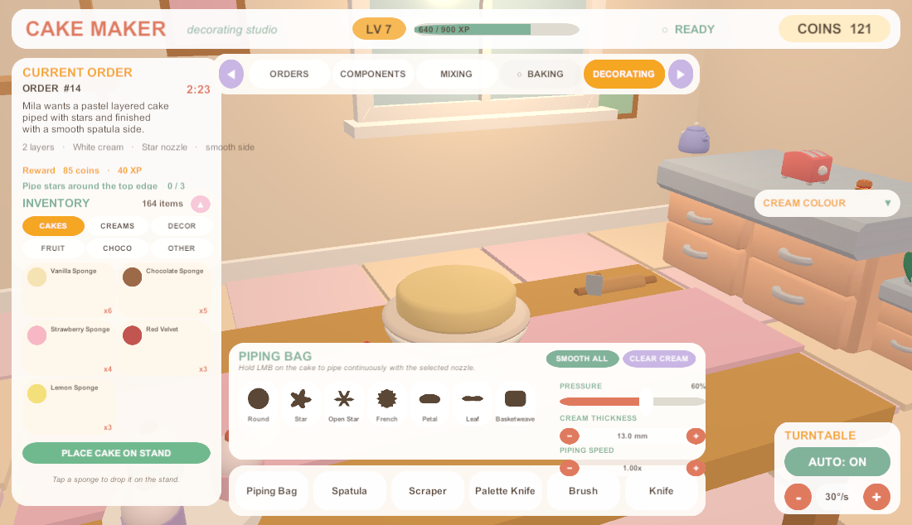
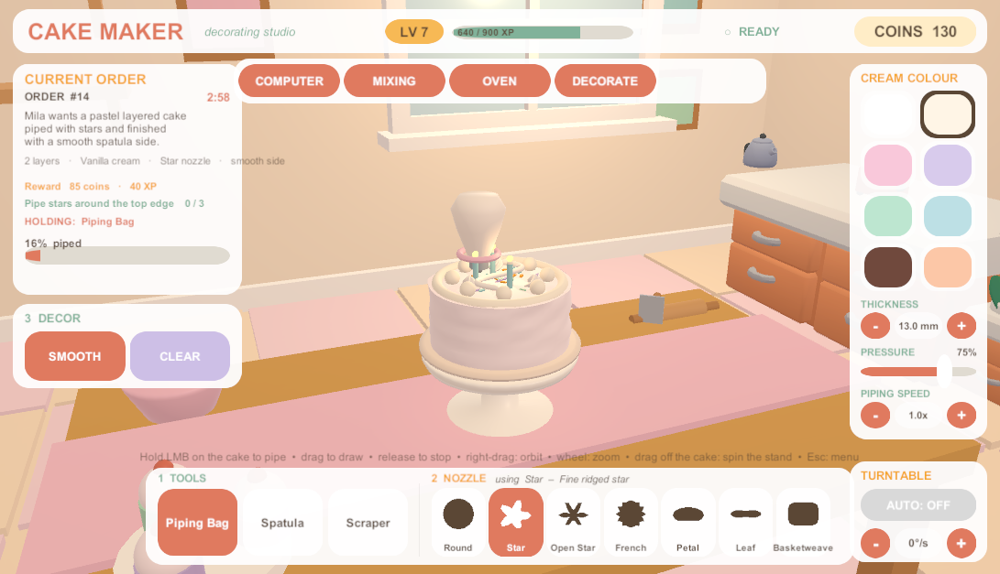
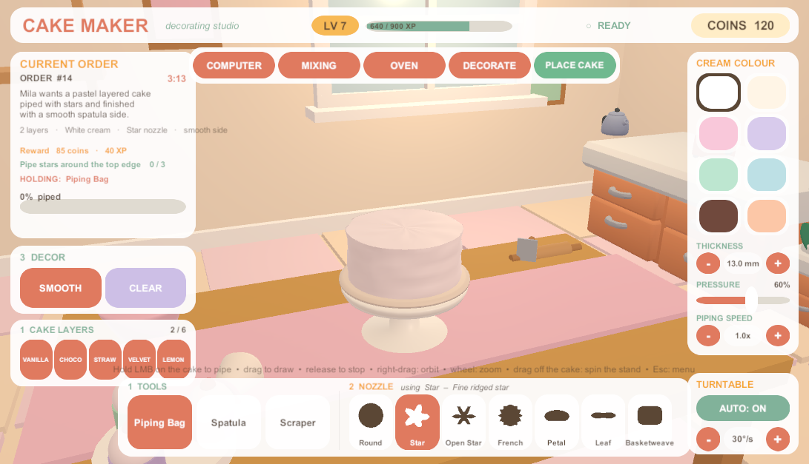
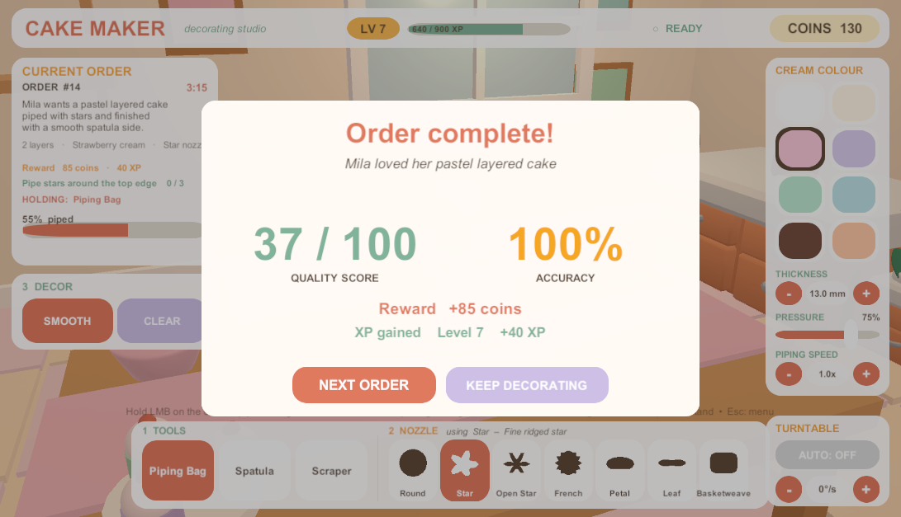
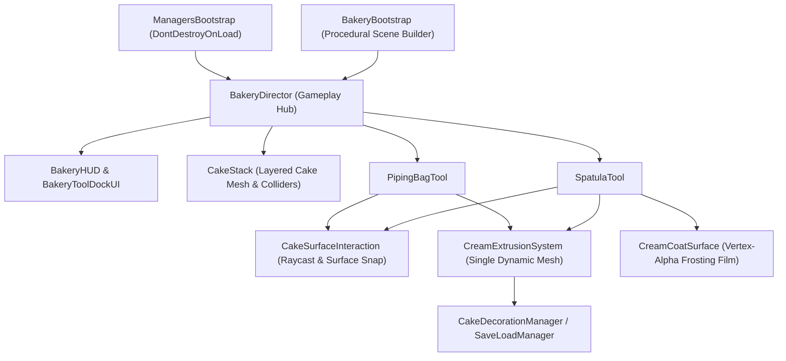

<div align="center">

[](../../README.md)


</div>

# 🎂 Poffle — Cozy 3D Cake Decorating Simulation

> *A cozy little bakery where craftsmanship, pastel aesthetics, and real-time procedural cake decorating come together.*
>
> 📌 **Not / Note:** Bu sayfa projenin **genel vitrin ve teknik mimari dokümantasyonudur (Project Showcase)**. Kaynak kodları ticari gizlilik nedeniyle özel (**Private**) repoda tutulmaktadır.



---

## 📖 Proje Hakkında (Overview)

**Poffle (Cake Maker)**, oyuncuların sıcak ve rahatlatıcı bir pastane atölyesinde müşterilerden gelen özel pasta siparişlerini gerçek zamanlı 3B araçlarla hazırladığı **Cozy 3D Pasta Süsleme Simülasyonu** oyunudur.

Stres yaratmayan, tamamen el işçiliği (craftsmanship), estetik ve yaratıcılık odaklı bir deneyim sunar. Oyuncular pandispanya katmanlarını üst üste dizer, döner tabla (turntable) üzerinde spatulayla pürüzsüz krema kaplaması yapar ve 7 farklı duy (nozzle) başlığına sahip krema sıkma torbası (piping bag) ile üç boyutlu süslemeler işler.

### 🎯 Temel Özellikler
- **Gerçek Zamanlı 3B Krema Sıkma (Procedural Cream Extrusion):** Tek bir dinamik mesh üzerinde alt-adımlama (sub-stepping), yüzey yakalama (surface snapping) ve 7 farklı duy kesitiyle (Round, Star, Open Star, French Star, Petal, Leaf, Basketweave) gerçek zamanlı şerit (ribbon) ve puf (dollop) sıkma mekaniği.
- **Pürüzsüz Spatula & Kaplama (Frosting Film):** Spatula ve kazıyıcı (scraper) araçlarıyla sıkılmış kremaları düzeltme, silme ve pasta yüzeyinde pürüzsüz krema katmanı oluşturma.
- **Çok Katmanlı Pasta İnşası (Cake Stack):** Vanilya, çikolata, çilek, Red Velvet ve limonlu pandispanya katmanlarını envanterden sürükleyip stand üzerinde katmanlı olarak dizme.
- **Döner Tabla (Turntable) Kontrolü:** Otomatik döndürme (hız ve yön ayarlı) veya serbest kamera/tabla kontrolü ile simetrik süsleme imkanı.
- **Sipariş & Kalite Değerlendirme Döngüsü:** Müşteri siparişlerindeki katman, krema rengi, duy tipi ve kaplama kriterlerine göre **Kalite Puanı (Quality Score)** ve **Doğruluk (Accuracy)** hesaplaması; altın ve XP kazanımı.
- **Kalıcı Kayıt Sistemi (Save/Load):** Ekonomi, sipariş durumu, yetenek ilerlemesi ve pasta üzerindeki tüm krema darbelerinin (`CreamSaveData`) JSON tabanlı yerel kayıt sistemiyle saklanması.

---

## 📸 Ekran Görüntüleri (Screenshots)

### 🏠 Pastane Atölyesi & Dinamik Arayüz (Workstation & HUD)
Envanter yönetimi, katman seçimi, krema renk paleti, basınç/kalınlık ayarları ve döner tabla kontrolleri:


### 🧁 Krema Sıkma Torbası & 7 Farklı Duy Profili (Piping & Nozzles)
Gerçek zamanlı krema sıkma, mum/süsleme yerleşimi ve pasta önünü kapatmaması için otomatik yarı-saydamlaşan (`Tool Fade`) sıkma torbası:


### 🔪 Spatula ile Pürüzsüz Krema Kaplama (Smooth Frosting)
Spatula ve Scraper araçlarıyla pürüzsüzleştirilmiş pastel pasta yüzeyi ve istasyonlar arası hızlı geçiş:


### ⭐ Sipariş Teslimi & Kalite Değerlendirmesi (Order Complete)
Sipariş gereksinimlerine göre kalite ve doğruluk puanlaması, XP ve Coin ödülleri:


---

## 🏗️ Teknik Mimari (System Architecture)

Proje **Unity 6 (6000.5.6f1)** ve **Built-in Render Pipeline** üzerinde, prefab bağımlılığını en aza indiren **Code-Driven (Kod Tabanlı) Prosedürel Mimari** yaklaşımıyla geliştirilmiştir.

### 1. Katman ve İsim Alanı (Namespace) Yapısı

| Namespace | Sorumluluk Alanı |
|---|---|
| `CakeMaker.Core` | `ManagersBootstrap`, `GameManager`, `EventBus`, `EconomyManager`, `OrderManager`, `SaveLoadManager` |
| `CakeMaker.Prototype` | Aktif oyun içi sistemler: prosedürel pasta/krema üretimi, araçlar, kamera, sahne ve HUD kurulumu |
| `CakeMaker.Data` | `ScriptableObject` tabanlı veri tanımları (siparişler, tarifler, araçlar, yetenekler, kalite kriterleri) |
| `CakeMaker.Gameplay.*` | İstasyon, araç ve oyuncu etkileşim altyapısı |
| `CakeMaker.UI` | Ana menü (`MainMenuController`), oyun içi menü ve 3B menü pastası kontrolcüleri |

### 2. Temel Sistem Sınıfları (`CakeMaker.Prototype`)



- **`PrototypeKit`**: Prosedürel torna (lathe) mesh üretimi, pastel/atlas materyal önbellekleme ve 3B mutfak modelleri kurulumu.
- **`NozzleProfiles`**: 7 farklı duy kesitinin matematiksel profili, UI önizleme ikonları ve 3B duy mesh üretimi.
- **`CreamExtrusionSystem`**: Sıkılan tüm kremaları **tek bir dinamik Mesh** içinde yöneten çekirdek motor. Şerit süpürme (ribbon sweep), puf (dollop) üretimi, fırça ile silme (`EraseBrush`) ve darbe kaydı (`CreamSaveData`) işlemlerini yürütür.
- **`CakeSurfaceInteraction`**: Fare ışınlarını (raycast) pasta yüzeyine (`Cake` layer) düşürür ve noktaları üst düzlem veya silindirik yan yüzeye izdüşürür (`ProjectToSurface`).
- **`CreamCoatSurface`**: Spatula ile yayılan pürüzsüz krema tabakasını vertex-alpha yoğunluğu ile gerçek zamanlı günceller.
- **`BakeryDirector`**: Araç seçimi, sıkma basıncı, krema renk paleti, sipariş döngüsü, istasyon kameraları ve kalite puanlamasını koordine eden ana merkez.
- **`BakeryBootstrap` & `BakeryHUD`**: Tüm pastane odasını, ışıklandırmayı, mobilyaları ve kullanıcı arayüzünü çalışma zamanında veya editör araçlarıyla koddan inşa eder.

### 3. Gerçek Zamanlı Krema Veri Akışı (Cream Data Flow)

```text
Fare Girişi (LMB)
  └─► CakeSurfaceInteraction.TryGetSurfacePoint()       [Pasta collider'ına Raycast]
        └─► PipingBagTool.EmitAt()                      [Adım aralığı & Ribbon / Dollop kararı]
              └─► CreamExtrusionSystem.AddPoint()       [Dünya -> Pasta yerel uzayı, yüzeye snap]
                    └─► Ring Emission                   [Kesit halkalarının vertex/normal/color tamponlarına eklenmesi]
                          └─► LateUpdate Apply()        [Tek bir Mesh üzerinde SetVertices / SetNormals / SetColors]

Spatula Sürükleme
  └─► SpatulaTool.UpdateHover()
        ├─► CreamExtrusionSystem.EraseBrush()           [Yakındaki krema örneklerini siler, darbeleri böler ve mesh'i yeniler]
        └─► CreamCoatSurface.Spread()                   [Kaplama filmini yükseltir ve tepe rengini boyar]
```

### 4. Özel Shader'lar (Custom Shaders)

| Shader | Kullanım Amacı |
|---|---|
| `CakeMaker/Cream (Vertex Color)` | Sıkılan kremanın her darbede kendi rengini koruması için vertex-color tabanlı Standard aydınlatmalı yüzey shader'ı |
| `CakeMaker/Cream Coat` | Spatula ile yayılan krema katmanı için vertex alpha tabanlı (`ZWrite Off`) yarı saydam kaplama shader'ı |
| `CakeMaker/Tool Fade` | Krema torbasının kamerayla pasta arasına girdiğinde görüşü kapatmaması için dinamik saydamlaşma shader'ı |

---

## 🎮 Oynanış Döngüsü (Core Game Loop)

1. **Siparişi Al (Receive Order):** Sol üstteki sipariş kartından müşterinin istediği katman sayısını, krema rengini, duy tipini ve süsleme detaylarını incele.
2. **Katmanları Diz (Stack Layers):** Envanterden pandispanya katmanlarını seçip döner tabla üzerine yerleştir.
3. **Kapla ve Süsle (Coat & Pipe):**
   - **Spatula / Scraper** ile pastanın taban kremasını pürüzsüzleştir.
   - **Piping Bag** ile 7 farklı duy başlığından birini seç, krema rengini, kalınlığını (`mm`) ve basıncını (`%`) ayarlayarak pastayı süsle.
   - **Turntable** hızını ayarlayarak simetrik kenar şeritleri ve yıldız motifleri oluştur.
4. **Teslim Et ve Geliş (Evaluate & Progress):** Siparişi tamamla, kalite ve doğruluk puanına göre Coin ve XP kazan, seviye atlayarak pastaneni büyüt.

---

## 🔒 Lisans & Telif Hakkı (License)

Bu proje ve kaynak kodları özel mülkiyettir (**All Rights Reserved**). İzinsiz kopyalanamaz, dağıtılamaz veya ticari amaçla kullanılamaz.
